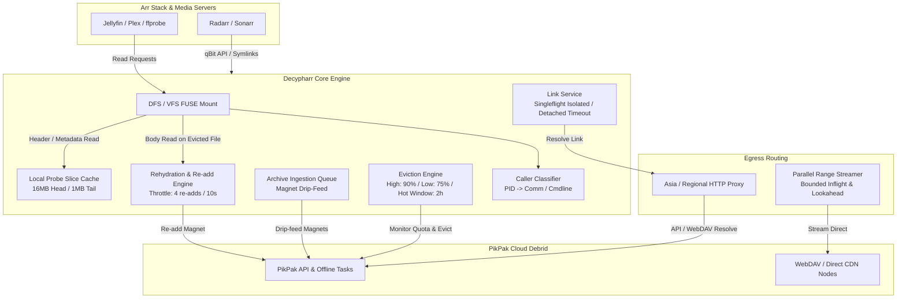

# Decypharr — Eviction Branch Changes Summary

This document provides a comprehensive technical overview of all changes, features, and optimizations developed on the `eviction` branch relative to `main`.

---

## 1. Executive Summary

The primary goals of the `eviction` branch are:
1. **PikPak as a Cloud Debrid Provider**: Full native integration of PikPak cloud storage and offline downloading into decypharr's debrid abstraction layer, including quota reporting, account lifecycle management, link resolution, and download completion tracking.
2. **Specialized Proxy & Egress Routing**: A dual-tier network architecture separating API control-plane / link resolution (routed through a regional/Asia proxy to bypass PikPak regional rate caps) from bulk media streaming (transferred direct to maximize throughput without bottlenecking proxy bandwidth), combined with parallel range requests and HTTP/2 connection health management.
3. **Quota-Based Eviction & Archive Mode**: Storage quota enforcement for quota-constrained providers that evicts oldest content past high-water thresholds down to low-water targets while retaining metadata locally for lazy re-hydration on playback. Includes an aggressive "Archive Mode" to ingest arbitrary library sizes via magnet drip-feeding.
4. **Local Probe Slice Caching**: Storing head (16 MB) and tail (1 MB) slices on local disk for evicted media, allowing media servers (`ffprobe`, Jellyfin, Plex) and `*arr` scanners to read metadata and container headers without triggering expensive remote re-download storms.
5. **Arr Stack Integration & Rehydration**: Transparent lazy re-hydration on VFS/FUSE read paths, *arr queue monitoring, folder name and release year recovery, bad link detection with automatic blocklisting and re-searching via *arr APIs, orphaned entry preservation, and a history-based rebuild engine (`/api/repair/rebuild-from-history`).

---

## 2. Core Architectural & Feature Overview

---

### 2.1 PikPak Debrid Provider Integration
- **Client Implementation (`pkg/debrid/providers/pikpak/`)**:
  - Implements `debrid.Client` and `debrid.QuotaReporter`.
  - Authenticates using `username:password` format inside the `api_key` configuration field (supporting email and phone logins).
  - Derives a persistent, deterministic device ID from user credentials to prevent new-device verification challenges on restart.
  - Automatic access and refresh token management with concurrency locking (`profileMu`).
  - Requires `download_uncached: true` because PikPak processes all magnet links asynchronously as cloud tasks.
  - Cache detection logic uses `predict_type` (type 3 = cached, type 1 = uncached) with a dedicated grace window (`cacheCheckGrace = 10s`, `cacheCheckWindow = 30s`) to avoid false-negative rejections.
  - Quota reporting via `StorageQuota(ctx)` queries `getAbout` API for used and total bytes.
  - Documentation added at `docs/src/content/docs/guides/debrid/pikpak.md` and integrated into UI configuration wizard (`pkg/server/assets/js/config.js`, `pkg/server/templates/setup.html`).

---

### 2.2 Advanced Proxy & Egress Routing Architecture
- **API-Only Proxy with Direct Streaming (`StreamDirect`)**:
  - `StreamDirect: bool` in `internal/config/debrid.go`.
  - PikPak applies region-based bandwidth caps at **link resolution time**. Resolving through an Asia/regional proxy causes PikPak to issue an unthrottled `.net` "original" link tier.
  - Once resolved, streaming byte transfers directly bypasses the proxy (`StreamViaProxy: false`), avoiding costly relay bandwidth and server bottlenecks.
  - If WebDAV resolution fails and falls back to a `.com` web link, decypharr flags `StreamViaProxy: true` so the transfer goes through the proxy to bypass the ~200 KB/s regional cap.
- **Link Speed Cap Detection (`SpeedCapBps`)**:
  - Parsed from PikPak link parameters (`ms` and `th`). Detects `x_limited=1` content-level throttle flags.
- **Parallel Range Reads (`pkg/manager/stream.go`, `internal/config/mount.go`)**:
  - High-latency overseas connections are often TCP window/RTT bounded.
  - Configurable `ReadStreams` (number of concurrent range requests), `ReadStreamChunk` (min chunk size, default 2MB), and `SingleStreamCap` (skips concurrency if single connection speed is above threshold, default 15MB/s).
  - Dual-budget architecture in `fetchRangeParallel`:
    - `inflight`: concurrency limit on network connections, released immediately upon chunk fetch.
    - `lookahead`: memory buffer limit, released only after chunk is written sequentially to output. Prevents memory explosion while eliminating head-of-line blocking stalls.
- **HTTP/2 Health Checks (`internal/request/request.go`)**:
  - PikPak load balancers enforce a limit of ~2000 multiplexed streams per HTTP/2 connection, subsequently issuing `GOAWAY` frames.
  - Configured active HTTP/2 transport health checking with `ReadIdleTimeout = 30s` and `PingTimeout = 15s` via `http2.ConfigureTransports`, automatically evicting dead/capped connections without process restarts.

---

### 2.3 Quota-Based Eviction & Archive Mode
- **Eviction Core (`pkg/manager/eviction.go`)**:
  - Scheduled sweep running at `check_interval` (default 15m).
  - Single-instance execution enforced via `evictionRunning` atomic CAS to prevent concurrent sweep races.
  - Evicts oldest completed torrents down to `low_water_percent` (default 75%) when storage exceeds `high_water_percent` (default 90%).
  - Local database entries remain intact; remote placement is marked with `RemovedAt`.
  - **Hot Window Protection**: Titles streamed within `hot_window` (default 2h) are protected from eviction.
- **Archive Ingestion Mode (`pkg/manager/ingest.go`)**:
  - Configured via `eviction.archive: true`.
  - Manages a file-backed magnet queue at `db/ingest_queue.txt`.
  - Drip-feeds magnets in batches (`feed_batch`, default 5) whenever storage is below `feed_target_percent` (default 70%).
  - Completed downloads are immediately evicted down to their head/tail probe slices, enabling massive virtual libraries on limited cloud storage.
- **HTTP Endpoints (`pkg/server/api_eviction.go`)**:
  - `GET /api/eviction/status/{debrid}`: returns quota usage and eviction stats.
  - `POST /api/eviction/evict/{hash}`: manually evicts an entry.
  - `POST /api/eviction/ingest`: enqueues magnet links.
  - `GET /api/eviction/ingest`: reports ingest queue depth.

---

### 2.4 Probe Slice Cache (Metadata Scan Guard)
- **Probe Cache Engine (`pkg/manager/probecache.go`)**:
  - Retains head (default 16 MB) and tail (default 1 MB) slices locally on disk in `db/probecache/`.
  - Unique temporary files (`os.CreateTemp`) prevent race conditions during concurrent sweeps.
  - Serves `ffprobe` container inspections, metadata extraction, and seek-to-tail operations without touching remote storage or triggering re-adds.
  - Real re-hydration is only triggered on reads into the file body.

---

### 2.5 Arr Stack Integration & Rehydration Engine
- **VFS / FUSE Read-Path Lazy Rehydration (`pkg/mount/dfs/vfs/downloaders.go`, `pkg/manager/eviction.go`)**:
  - In FUSE `Downloaders.Download()`, evicted entries are rehydrated via `EnsureHydrated` *before* hitting circuit breakers or watchdogs.
  - Concurrent reads on the same evicted file coalesce into a single re-add via `rehydrateCall`.
  - Burst rate limiter (`rehydrateThrottle`): allows at most 4 re-adds within a 10s rolling window, protecting accounts against rapid library scans.
- **Orphan Preservation & Rebuild from History (`pkg/manager/rehydrate_arr.go`, `internal/config/debrid.go`)**:
  - `RehydrateOrphaned: true`: when files vanish from a debrid account (account rotation or out-of-band deletion), decypharr marks them as orphaned for lazy rehydration instead of deleting them, preventing broken `*arr` library symlinks.
  - `RebuildFromArrHistory` (`POST /api/repair/rebuild-from-history`):
    - Inspects Radarr and Sonarr libraries for broken symlinks.
    - Queries `*arr` history for the original grab `downloadId` (torrent infohash).
    - Restores the entry locally in orphaned state without re-downloading from the debrid.
    - Supports `dry_run=true` and `?arr=<name>` query parameters.
- **Release Title & Year Recovery (`pkg/arr/history.go`, `pkg/manager/processor.go`, `internal/utils/regex.go`)**:
  - When PikPak strips release titles and years (leading to *arr "Unable to parse file" import errors), decypharr queries the *arr queue with `includeMovie=true` to obtain clean title and release year.
  - `utils.SafeFolderName` sanitizes directory names within the 240-byte UTF-8 limit while preserving essential year and tag tokens.
- **Unusable Link Detection & Automatic Re-Search**:
  - `waitForUsableLink` validates that files have valid download URLs.
  - Unusable links trigger `BlackListAndResearchItems` against the *arr API, automatically removing the bad release and requesting a new grab.
- **qBittorrent API Logging (`pkg/server/qbit/http.go`)**:
  - `logTorrentDeletion` warns when `*arr` deletes a torrent that has unimported files in its download directory.

---

### 2.6 Performance & Filesystem Optimizations
- **VFS Cache Optimizations (`pkg/mount/dfs/vfs/cache.go`)**:
  - Coalesced metadata writer (`metaWriterLoop`): debounces per-write flush signals with a time gate, eliminating a write storm that consumed ~28% CPU during streaming.
  - Coalesced `posix_fadvise` ranges (`drainFadvise`, `mergeFadviseRanges`): merges contiguous chunk hints before syscall execution, reducing CPU consumption by ~24%.
  - `DFS_DISABLE_FADVISE` environment variable: escape hatch to disable `FADV_DONTNEED` and prevent read amplification on contended disks.
- **Caller Process Classification (`pkg/mount/dfs/backend/hanwen/caller*.go`)**:
  - Resolves FUSE caller PID to `/proc/<pid>/comm` and command line on Linux/macOS.
  - Labels streams (`probe`, `trickplay`, `transcode`, `ffmpeg`, `read`) for diagnostics and stream prioritization.
- **Deduplication Engine (`pkg/storage/misc.go`, `internal/utils/regex.go`)**:
  - `dedupeFileCopies`: strips `(1)`, `(2)` duplicate suffixes created by PikPak re-downloads and collapses them into a single entry with the latest timestamp.
  - Stable folder name fallback in `pkg/storage/types.go` to prevent root `/__all__` collapses.
- **Resilient Link Validation (`pkg/manager/link/service.go`)**:
  - Singleflight calls use a detached background context bounded by `linkFetchTimeout` (2m). Caller cancellations no longer abort shared validation for other readers.
  - Non-terminal/transient errors (`context.Canceled`, network timeouts) are excluded from the validation cache to prevent permanent 500 errors on subsequent reads.
  - Range-probe GET (`Range: bytes=0-0`) replaces HEAD requests to handle hosts (like PikPak WebDAV) that reject HEAD with 403.

---

## 3. Configuration Reference

### 3.1 Debrid Configuration (`debrids[]`)

| Field | Type | Default | Description |
|---|---|---|---|
| `provider` | string | - | Set to `"pikpak"` for PikPak integration. |
| `api_key` | string | - | `"username:password"` format for PikPak accounts. |
| `download_uncached` | bool | `true` | Required for PikPak due to asynchronous cloud downloading. |
| `proxy` | string | `""` | Proxy URL (e.g. `http://proxy-host:8080` or `socks5://...`). |
| `stream_direct` | bool | `false` | When true, proxy is used **only** for API/link resolution; media bytes are fetched direct. |
| `rehydrate_orphaned` | bool | `false` | Preserves local entries when removed remotely, allowing re-add on next play. |

### 3.2 Eviction Configuration (`debrids[].eviction`)

| Field | Type | Default | Description |
|---|---|---|---|
| `enabled` | bool | `false` | Master switch for quota-based eviction. |
| `high_water_percent` | int | `90` | Start eviction when usage exceeds this percentage. |
| `low_water_percent` | int | `75` | Evict down to this usage percentage. |
| `check_interval` | string | `"15m"` | How frequently quota is audited. |
| `rehydrate_wait_seconds` | int | `20` | Max blocking duration for on-demand rehydration. |
| `header_cache_mb` | int | `16` | Size of head probe slice stored locally on disk. |
| `tail_cache_mb` | int | `1` | Size of tail probe slice stored locally on disk. |
| `archive` | bool | `false` | Enables Archive Ingestion Mode. |
| `feed_target_percent` | int | `70` | Max quota target while drip-feeding magnets. |
| `feed_batch` | int | `5` | Number of magnets dispatched per sweep. |
| `hot_window` | string | `"2h"` | Streaming grace period protecting titles from eviction. |

### 3.3 Mount DFS Parallel Streaming (`mount.dfs`)

| Field | Type | Default | Description |
|---|---|---|---|
| `read_streams` | int | `1` | Number of concurrent HTTP range requests per read. |
| `read_stream_chunk` | string | `"2MB"` | Minimum chunk size per parallel stream. |
| `single_stream_cap` | string | `"15MB"` | Speed threshold above which parallel streams are disabled to conserve CPU. |

### 3.4 Environment Variables

| Variable | Description |
|---|---|
| `DEBRID_<INDEX>_PROXY` | Proxy URL for debrid provider at `<INDEX>`. |
| `DEBRID_<INDEX>_STREAM_DIRECT` | Boolean flag for direct streaming bypass. |
| `MOUNT__DFS__READ_STREAMS` | Number of concurrent range read streams. |
| `MOUNT__DFS__READ_STREAM_CHUNK` | Minimum chunk size for parallel range streams. |
| `MOUNT__DFS__SINGLE_STREAM_CAP` | Single stream capacity threshold. |
| `DFS_DISABLE_FADVISE` | When non-empty, disables `posix_fadvise` page cache drops. |

---

## 4. API Endpoints Reference

| Method | Endpoint | Description |
|---|---|---|
| `GET` | `/api/eviction/status/{debrid}` | Returns storage quota, used bytes, limit bytes, and active sweeps. |
| `POST` | `/api/eviction/evict/{hash}` | Immediately evicts a specific torrent placement to probe slices. |
| `POST` | `/api/eviction/ingest` | Enqueues magnets for archive ingestion (accepts JSON array or newline-delimited text). |
| `GET` | `/api/eviction/ingest` | Returns count of pending magnets in the ingestion queue. |
| `POST` | `/api/repair/rebuild-from-history` | Reconstructs lost local entries from `*arr` symlinks and history (`?arr=<name>&dry_run=true`). |

---

## 5. File Modification Inventory

| Subsystem | File Path | Status | Summary of Changes |
|---|---|---|---|
| **Configuration** | `internal/config/debrid.go` | Modified | Added `StreamDirect`, `RehydrateOrphaned`, and `Eviction` configuration structs and env var bindings. |
| | `internal/config/mount.go` | Modified | Added `ReadStreams`, `ReadStreamChunk`, `SingleStreamCap` DFS options and env var bindings. |
| **HTTP Transport** | `internal/request/request.go` | Modified | Configured HTTP/2 active ping health-checks to avoid GOAWAY stream exhaustion. |
| **PikPak Provider** | `pkg/debrid/providers/pikpak/client.go` | Added | PikPak HTTP API client, authentication, task polling, and WebDAV link resolution. |
| | `pkg/debrid/providers/pikpak/pikpak.go` | Added | Implementation of `debrid.Client` and `QuotaReporter`, dual egress routing, and speed capping. |
| | `pkg/debrid/providers/pikpak/types.go` | Added | Request/response DTOs for PikPak API payloads. |
| **Debrid Common** | `pkg/debrid/account/manager.go` | Modified | Return errors rather than empty links to avoid destructive re-insertions. |
| | `pkg/debrid/common/interface.go` | Modified | Added `QuotaReporter` interface. |
| | `pkg/debrid/types/torrent.go` | Modified | Added `SpeedCapBps` and `StreamViaProxy` to `DownloadLink`. |
| **Eviction & Storage** | `pkg/manager/eviction.go` | Added | Quota evaluation sweeps, high/low water mark enforcement, hot window protection, burst throttle. |
| | `pkg/manager/probecache.go` | Added | Head/tail probe slice disk caching, atomic file creation, and slice serving. |
| | `pkg/manager/ingest.go` | Added | Archive ingestion queue management and magnet drip-feeding. |
| | `pkg/storage/misc.go` | Modified | Added `dedupeFileCopies` to fold `(N)` suffix duplicates. |
| | `pkg/storage/types.go` | Modified | Guaranteed non-empty `GetTorrentFolder` to avoid `/__all__` root collapses. |
| | `pkg/storage/dedup_test.go` | Added | Unit tests for duplicate file copy folding. |
| **Rehydration & Arr** | `pkg/manager/rehydrate_arr.go` | Added | Rebuilding missing entries from *arr symlinks and grab history. |
| | `pkg/arr/history.go` | Modified | Added `includeMovie=true` to Radarr queue queries to recover clean titles/years. |
| | `pkg/manager/processor.go` | Modified | Folder name year recovery from Arr queue, unusable link gate with automatic re-search. |
| | `pkg/manager/torrent.go` | Modified | Preservation of evicted and orphaned placements during periodic sync sweeps. |
| | `pkg/server/qbit/http.go` | Modified | Added deletion logging when *arr deletes torrents with unimported files. |
| **Streaming & VFS** | `pkg/manager/stream.go` | Modified | Added `parallelReadSettings` and `fetchRangeParallel` for concurrent range streaming. |
| | `pkg/manager/debrid.go` | Modified | Proxy-bound stream HTTP client caching via `streamClientFor`. |
| | `pkg/manager/link/service.go` | Modified | Context-detached singleflight validation, transient error caching prevention, 1-byte ranged GET. |
| | `pkg/mount/dfs/vfs/downloaders.go` | Modified | Up-front `EnsureHydrated` check before circuit breaker; caller tracking. |
| | `pkg/mount/dfs/vfs/cache.go` | Modified | Debounced metadata flush loop, coalesced `posix_fadvise`, and `DFS_DISABLE_FADVISE`. |
| | `pkg/mount/dfs/vfs/file.go` | Modified | Stream caller attribution support. |
| | `pkg/mount/dfs/backend/hanwen/caller*.go` | Added | PID inspection and caller classification heuristics (probe, trickplay, transcode, ffmpeg). |
| **API & Server** | `pkg/server/api_eviction.go` | Added | HTTP handlers for quota status, manual eviction, ingestion queue, and history rebuild. |
| | `pkg/server/routes.go` | Modified | Registered eviction and rebuild endpoints in WebRoutes router. |
| | `pkg/server/setup.go` | Modified | PikPak provider initialization in server setup. |
| | `pkg/server/assets/js/config.js` | Modified | PikPak provider support in UI dashboard settings. |
| | `pkg/server/templates/setup.html` | Modified | PikPak credentials input in web setup wizard. |
| **Documentation** | `docs/src/content/docs/guides/debrid/pikpak.md` | Added | User guide for configuring PikPak with decypharr. |
| | `docs/astro.config.mjs` & `README.md` | Modified | Registered PikPak guide in documentation sidebar and README. |
| **Utilities** | `internal/utils/regex.go` | Modified | Added `yearRegex`, `dupSuffixRe`, `NormalizeDupName`, `HasYear`, and `SafeFolderName`. |
| | `internal/utils/folder_name_test.go` | Added | Unit tests for year extraction and safe folder name generation. |

---

## 6. Commit Log on Eviction Branch

The following 27 commits form the history of the `eviction` branch:

1. `e132769` — Add quota-based eviction with lazy re-hydration for PikPak
2. `285c09b` — Add archive ingestion: drip-feed magnets and reduce to probe slices
3. `63a68cf` — Re-hydrate evicted files on the FUSE/VFS read path
4. `851b20d` — Keep recently-watched titles resident; only re-hydrate on body reads
5. `d17fb8d` — Fix overlapping archive sweeps racing on probe-cache temp files
6. `ce7883a` — Fix archive-path crash: bypass repair/refresh, add nil guard + EOF retry
7. `b017cb0` — Fix Radarr/Arr symlink hang: populate PikPak OriginalFilename
8. `045e70e` — Stop caching transient link-validation errors that poison reads
9. `38f517f` — Fall back to release name when PikPak's cached name has no year
10. `1286d77` — Recover year-less folder name from the *arr queue for import parsing
11. `f40008c` — Fix arr-name recovery: resolve configured arr + add diagnostics
12. `921b5e7` — Use linked movie title+year when arr queue release-title is blank
13. `70fabb2` — Stop just-downloaded PikPak entries from being marked bad
14. `ae7d645` — Trash duplicate PikPak copies of the same torrent on refresh
15. `33353cd` — Collapse PikPak duplicates in-memory; make trash-dedup safe
16. `f67f14b` — Replace entry file list on re-add so stale (N) copies don't accumulate
17. `38dd3b0` — Collapse re-add file copies in the entry merge (the real accumulator)
18. `eb88f5c` — Drop destructive PikPak dup-trashing; rely on non-destructive dedup
19. `b21ac88` — Don't swallow download-link errors into an empty link (re-insertion engine)
20. `057e075` — Validate PikPak download URLs; fall back direct when WebDAV URL is invalid
21. `d181edb` — Log getFile result when no download URL resolves
22. `ff23e18` — Fail downloads with no usable link so the *arr retries another release
23. `2245289` — Move no-usable-link gate to processAction (the real completion choke point)
24. `3646303` — Blocklist+re-search unusable downloads instead of just erroring
25. `7fd423f` — Drop the WebDAV->direct link fallback; resolve via WebDAV only
26. `e6032c6` — Health-check HTTP/2 connections so stale ones don't need a restart
27. `1dddec8` — feat: add pikpak support and other changes
